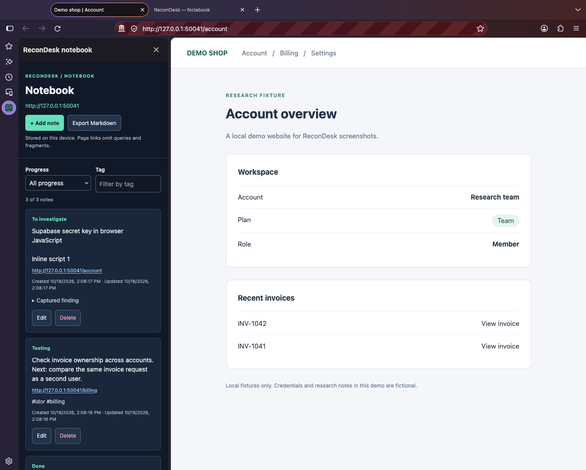
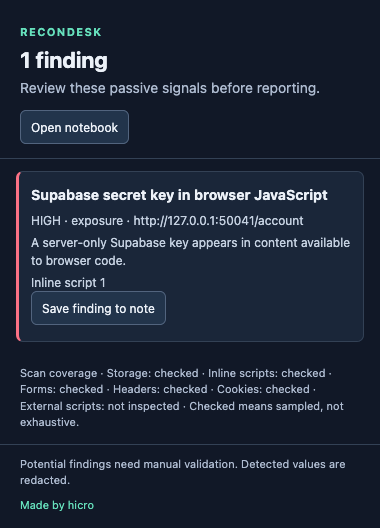
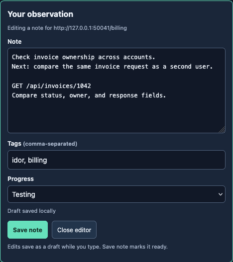

<p align="center">
  
</p>

<h1 align="center">ReconDesk</h1>

<p align="center"><strong>Your browser-based recon workspace.</strong></p>

<p align="center">
  
  
  
  
</p>

ReconDesk is a Firefox recon companion for bug bounty research. Discover passive security leads, capture evidence, and organize site-specific notes as you investigate.

It scans pages you visit, shows a finding count on the toolbar, and keeps findings and notes locally. No validation requests, uploads, or runtime dependencies.



Keep your investigation beside the website. Screenshots use local fixtures and fictional research data.

## Install permanently

Requires **Firefox 142+**. Standard Firefox requires a **Mozilla-signed `.xpi`**, even for personal use. A local ZIP or unsigned XPI is not enough; a public add-ons listing is optional.

### Create a signed package

1. Before first signing, choose a unique, permanent `browser_specific_settings.gecko.id` in `extension/manifest.json`; the current ID is for development.
2. With Node.js and npm installed, run from the repository root:

   ```sh
   npm ci
   npm run build:extension
   ```

3. Sign in to the [Mozilla Add-on Developer Hub](https://addons.mozilla.org/developers/) and choose **Submit a New Add-on** → **On your own** (unlisted/self-distributed).
4. Upload the ZIP from `web-ext-artifacts/`, complete the submission, and download the **signed `.xpi`** when available. Signing submits the extension's code to Mozilla; it does not upload your local notes or findings.

### Install the signed XPI

1. Open `about:addons` in Firefox.
2. Choose the gear menu → **Install Add-on From File…**, select the signed `.xpi`, and approve installation and website access.
3. Visit an HTTP/HTTPS page and open ReconDesk from the extensions menu; pin it to the toolbar for easy access.

The extension stays installed across restarts. For updates, keep the same add-on ID, increase `version` in the manifest, build and sign a new version under the same Developer Hub entry, then install its signed XPI over the existing version. Local source edits do not update an installed package.

See Mozilla's [signing guide](https://extensionworkshop.com/documentation/publish/signing-and-distribution-overview/) and [installation guide](https://extensionworkshop.com/documentation/publish/install-self-distributed/).

## Use

The popup shows severity, confidence, redacted evidence, page context, and scan coverage. These are **leads to review, not confirmed vulnerabilities**. See [FINDINGS.md](FINDINGS.md) for all 19 rules and sampling limits.



Review passive signals and save useful evidence to your notebook.

- **Checked** means sampled, not exhaustive; **partial** means blocked or limited; **not inspected** means unobserved. **No findings** does not mean secure.
- New documents and reloads clear findings, coverage, and the badge. SPA/fragment changes rescan page-local sources while retaining document headers and external-script observations. Page sampling repeats every 30 seconds; the popup refreshes automatically.
- Headers and external scripts are inspected as responses arrive. **Reload an already-open page after installation** to capture them; periodic scans cannot replay past traffic. No external script requests means that source can remain uninspected.
- Findings retain a bounded, sanitized path, with long, encoded, and common credential-bearing segments redacted. Query strings, fragments, credential values, and script bodies are not saved in findings. Current-page results are deduplicated and stored locally for background recovery.

The extension needs cookie, storage, scripting, navigation, request-observation, HTTP/HTTPS website, and response-filter permissions. Response bytes pass through unchanged; scripts are not fetched again. It cannot scan protected Firefox pages or unopened search results, confirm exploits, or validate tokens or backend permissions. False positives and missed findings are possible.

### Recon notebook

Click **Open notebook** in the popup to open Firefox's sidebar.



Capture observations and next steps with page context and draft autosave.

- **Add note / Edit / Delete:** separate cards with multiline text, comma-separated tags, timestamps, and **To investigate / Testing / Done** progress. Filter by tag or progress.
- **Drafts:** edits autosave; wait for **Draft saved locally** to confirm storage finished. **Save note** marks the card ready; **Close editor** keeps its saved draft available through **Edit**.
- **Site context:** notes share an exact origin; schemes, subdomains, and ports stay separate. Each card keeps its original origin/path link, without URL credentials, queries, or fragments. Manual note text is preserved as entered.
- **Tab switching:** the sidebar follows its window's active tab; an open editor stays attached to its original site/page.
- **Conflicts:** stale edits cannot overwrite another window's changes. Copy text you want to keep, close the editor, and reopen the latest card to reconcile.
- **Save finding to note:** preserves the finding's title, severity, confidence, and redacted evidence after navigation. Editing note text leaves the original snapshot under **Captured finding**.
- **Export Markdown:** downloads the entire current-site notebook, including drafts, filtered-out cards, metadata, links, and captured evidence.

Notes stay in your Firefox profile across restarts for an installed add-on; they are not synced or uploaded. Export important research before removing the extension or clearing its storage.

## Development

For a temporary install, open `about:debugging#/runtime/this-firefox` → **Load Temporary Add-on** → select `extension/manifest.json`. Temporary add-ons disappear after Firefox restarts. Export notes before removing one or changing its ID.

After source edits, **Reload** the temporary add-on in `about:debugging`, then reload the website. For **Reload add-on** or **Background error**, do the same; if it persists, choose **Inspect** and check the first console error. Other popup states distinguish scanning, page access pending, protected pages, and scan failures.

### Quick check

```sh
python3 -m http.server 8765 --directory fixtures
```

Visit `http://127.0.0.1:8765/` in a new tab. Fake credentials should produce a badge and findings for storage, scripts, and missing CSP; counts vary with cookies and response timing. Try `http://127.0.0.1:8765/?access_token=fixture-token-value-123` for URL detection. Stop the server with Ctrl+C.

### Tests

```sh
npm run check
npm run lint:extension
```

Node's built-in runner covers detection, extension wiring, popup/sidebar behavior, persistence, concurrent writes, stale edits, delayed autosaves after deletion, storage failures, and extension-only notebook messaging.

For browser tests, install Selenium 4 (`python3 -m pip install selenium`) and provide Firefox and `openssl`. Selenium Manager resolves geckodriver.

```sh
python3 tests/firefox_smoke.py
python3 tests/notebook_firefox.py
# On macOS, append if Firefox is not discoverable:
# --firefox /Applications/Firefox.app/Contents/MacOS/firefox
```

- **Scanner:** isolated HTTP/HTTPS fixtures cover navigation, confirmed BFCache restores, reloads, SPA/fragments, real toolbar badges, redaction, and coverage. Lifecycle checks must finish within five seconds without the popup or periodic timer. Forty detection cases cover all 19 rules; an inventory check requires fixtures for new rules.
- **Notebook:** checks draft recovery, safe payload rendering, tags/progress, tab switching mid-edit, Markdown downloads, real popup finding capture, native sidebar opening, and persistence across an extension restart. WebDriver drives the unchanged sidebar document in an extension tab while a fixture stays active; it cannot directly address native sidebar content. Add `--screenshot /absolute/path.png` to capture the native sidebar.

Firefox lifecycle details: BFCache restores use `pageshow` with `persisted: true`, without rerunning content scripts or replaying network responses. After SPA navigation, `sender.url` can still be the original URL; the scanner supplies its captured URL, and the background checks its origin and current tab before accepting results. That raw URL is not persisted.

### Publishing

CI runs tests, syntax checks, and extension lint on pull requests and pushes to `master`. Publishing a stable GitHub release triggers validation, packaging, and submission to Firefox Add-ons. See [the publishing guide](docs/publishing.md) for the one-time Mozilla listing and GitHub secret setup, versioning, and review process.
